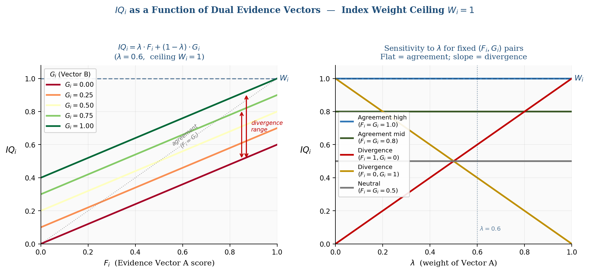

# Index Quality (IQ) Scoring Spec

*Prepared by Tabularium AI*

## Abstract

**Index Quality (IQ)** is a deterministic, bottom-up scoring model for official records indexing. Each index field carries a configuration-defined maximum weight. Two independent evidence vectors — one derived from semantic extraction, one from structural detection — act against that ceiling to produce a realized index score. The two vectors operate on disjoint signal domains: agreement between them increases confidence in the score; divergence is a diagnostic signal that flags extraction risk without requiring ground truth. Criterion scores aggregate to index scores, index scores to segment completeness, and segment scores to a document-level IQ score, auditable at every level. This document presents the mathematical framework; extraction pipelines and scoring parameters are proprietary.

## 1. Inputs

All scoring inputs originate from two sources, defined below. Derived quantities are computed from these sources exclusively.

**Ω (Configuration).** Instrument-type rules; for each segment *s* the applicable index set *Iₛ*; for each index *i ∈ Iₛ* the criterion set *Aᵢ* with per-criterion weights *wᵢ,a \> 0*, ambiguity-criticality flags *κᵢ,a ∈ {0,1}*, and the critical-key index set. Also: decision thresholds *τₚ ≥ τᵣ* and confidence default policy.

**Ε (Extraction Output).** For each criterion *a ∈ Aᵢ*: presence indicator *pᵢ,a ∈ {0,1}*, extraction confidence *cᵢ,a ∈ \[0,1\]* (clamped; default from Ω when unavailable), and ambiguity flag *αᵢ,a ∈ {0,1}*. The set of extracted criteria for index *i* is denoted *Ξᵢ ⊆ Aᵢ*.

***Figure 1. Dual Evidence Vectors Acting on Index Weight Ceiling***

Each index *i* carries a maximum weight *Wᵢ* defined in Ω. Evidence Vector A (semantic, from Ε) and Evidence Vector B (structural, from Ε) act independently against that ceiling. The realized index score *IQᵢ* = *Cᵢ / Wᵢ* reflects the combined reduction. Because the two vectors are derived from disjoint signal domains, their agreement or divergence is itself a quality indicator.

## 2. Definitions

Let *D* be a document under review. A **segment** *s* is a logical grouping of index fields (e.g., Titles, Party, Property, Monetary). An **index** *i ∈ Iₛ* is a specific field within *s* (e.g., Instrument #, APN, Party Name). Each index is characterized by a set of **criteria** *Aᵢ* drawn from Ω.

The **maximum achievable score** for segment *s* is:

$$E_{s} := \sum_{i \in I_{s}}^{}{\sum_{a \in A_{i}}^{}w_{i,a}}$$

> *Where:  
> Eₛ* - maximum achievable score for segment s;  
> *Iₛ* - applicable index set for s (from Ω);  
> *Aᵢ* - criterion set for index i (from Ω);  
> *wᵢ,a* - criterion weight (from Ω)

Segment *s* is **scorable** iff *Eₛ \> 0*. Non-scorable segments are excluded from all aggregation.

## 3. Criterion Scoring Model

### 3.1 Presence

Let *Ξᵢ ⊆ Aᵢ* be the set of criteria successfully extracted from *D* for index *i*. The presence indicator is:

$$p_{i,a} := \mathbf{1}\left[ a \in \Xi_{i} \right] , \quad p_{i,a} \in \{ 0, 1\}$$

> *Where:  
> pᵢ,a* - presence indicator (from Ε);  
> *Ξᵢ* - set of extracted criteria for index i (from Ε)

### 3.2 Ambiguity Penalty

Let *αᵢ,a ∈ {0,1}* be the ambiguity flag and *κᵢ,a ∈ {0,1}* the criticality flag. The penalty factor is:

$${pen}_{i,a} := \left\{ \begin{array}{l}
1.0 = \alpha_{i,a} = 0 \\
0.5 = \alpha_{i,a} = 1 \land \kappa_{i,a} = 0 \\
0.0 = \alpha_{i,a} = 1 \land \kappa_{i,a} = 1 
\end{array} \right. $$

> *Where:  
> penᵢ,a* - ambiguity penalty factor ∈ {0.0, 0.5, 1.0};  
> *αᵢ,a* - 1 if extraction output is not uniquely determined (from Ε);  
> *κᵢ,a* - 1 if the criterion is required (from Ω)

**Note:** A required criterion that is ambiguous scores 0 — critical fields must resolve without ambiguity.

### 3.3 Per-Criterion Score

The realized score for criterion *a* of index *i* is:

$$s_{i,a} := p_{i,a} \cdot c_{i,a} \cdot {pen}_{i,a}$$

> *Where:  
> sᵢ,a* - realized criterion score ∈ \[0,1\];  
> *cᵢ,a* - extraction confidence ∈ \[0,1\] (from Ε; default from Ω when unavailable)

### 3.4 Index Score

The weighted score for index *i* sums criterion contributions:

$$C_{i} := \sum_{a \in A_{i}}^{}{w_{i,a} \cdot s_{i,a}}$$

> *Where:  
> Cᵢ* - realized weighted score for index i

### 3.5 Segment Score

The realized score for segment *s* aggregates index scores:

$$V_{s} := \sum_{i \in I_{s}}^{}C_{i}$$

> *Where:  
> Vₛ* - realized score for segment s

The segment IQ score, defined for *Eₛ \> 0*:

$${IQ}_{s} := 100 \cdot \frac{V_{s}}{E_{s}} , \quad E_{s} > 0$$

> *Where:  
> IQₛ* - segment IQ score ∈ \[0, 100\];  
> *Vₛ / Eₛ* - fraction of maximum achievable score realized

## 4. Document Score

Let *Sᴵᵀ ⊆ S* be the set of scorable segments (*Eₛ \> 0*). The document IQ score is the arithmetic mean over scorable segments:

$${IQ}_{doc} := \frac{\sum_{s \in S_{IQ}}^{}{IQ}_{s}}{\left| S_{IQ} \right|}$$

> *Where:  
> IQₜₑₒ* - document IQ score ∈ \[0, 100\];  
> *Sᴵᵀ* - set of scorable segments; *\|Sᴵᵀ\|* - cardinality of Sᴵᵀ

## 5. Decision Logic

### 5.1 Hard Gate

Evaluated before scoring. If any critical-key index (default: Instrument #, Parties, APN/PIN) is absent from Ε, the document is **Rejected** unconditionally. The critical-key set is deployment-configurable but remains a non-negotiable reject condition.

### 5.2 Score-Based Decision

With thresholds *τₚ ≥ τᵣ* from Ω:

$$\begin{array}{l}
\text{Pass if} \quad {IQ}_{doc} \geq \tau_{p} \\
\text{Review} \quad \tau_{r} \leq {IQ}_{doc} < \tau_{p} \\
\text{Reject if} \quad {IQ}_{doc} < \tau_{r}
\end{array}$$

> *Where:  
> τₚ* - pass threshold (from Ω);  
> *τᵣ* - reject threshold (from Ω)

## 6. Worked Example

Single segment, two indexes. Numbers illustrative; deployments use configuration-defined weights.

***Segment: Reference \| Iₛ = {Instrument \#, Recording Date}***

| **Criterion a** | **Weight wᵢ,a** | **Presence pᵢ,a** | **Conf cᵢ,a** | **αᵢ,a** | **κᵢ,a** | **penaltyₐₘₙ** | **Cᵢ** |
|-----------------|-----------------|-------------------|---------------|----------|----------|----------------|--------|
| Instrument \#   | 10              | 1                 | 0.99          | 0        | 1        | 1.0            | 9.90   |
| Recording Date  | 5               | 1                 | 0.90          | 1        | 0        | 0.5            | 2.25   |

Applying the definitions:

Eₛ = 10 + 5 = 15

s₁ = 1 × 0.99 × 1.0 = 0.99 → C₁ = 10 × 0.99 = 9.90

s₂ = 1 × 0.90 × 0.5 = 0.45 → C₂ = 5 × 0.45 = 2.25

Vₛ = 9.90 + 2.25 = 12.15

IQₛ = 100 × (12.15 / 15) = 81.0

**Sensitivity:** Recording Date has αᵢ,a = 1 (ambiguous) and κᵢ,a = 0 (non-critical), so pen = 0.5. Had κᵢ,a = 1, pen = 0.0 and IQₛ = 100 × (9.90/15) = 66.0. If this were the only scorable segment, IQₜₑₒ = IQₛ.

## 7. Auditability

Every scoring run produces a complete audit record: decision with hard-gate failures listed by index name; *IQₜₑₒ*; per-segment *IQₛ* and *Vₛ / Eₛ*; per-index *Cᵢ*. For Review decisions: criterion-level reason codes identifying *pᵢ,a = 0*, *cᵢ,a* below threshold, or *αᵢ,a = 1*.

## Version History

*v1.0:* Core criterion scoring model and hard gate.  
*v2.0:* Structural evidence extension.  
v2.1: Incorporates corrections derived from the implementation and intensive test validation.
